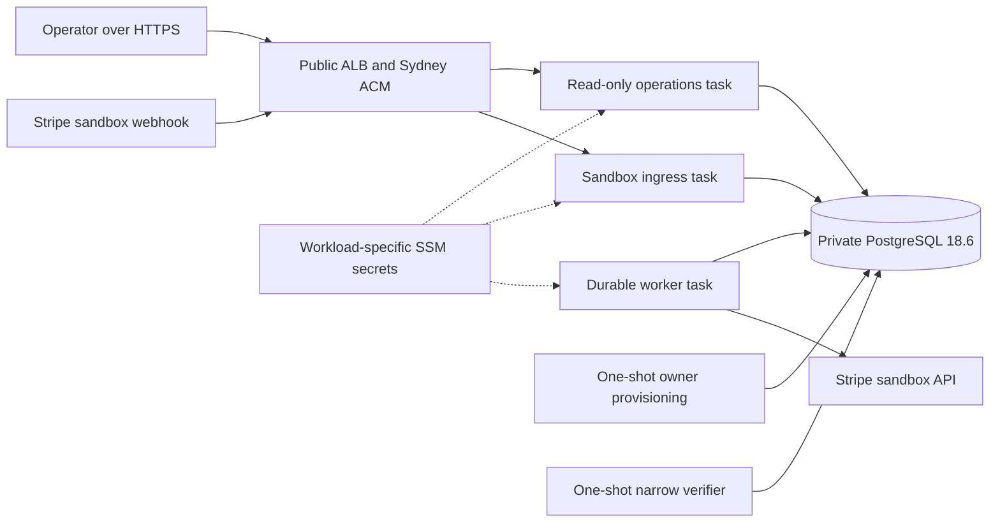

# Vigil deployment plan — new Sydney account

D1A local guards and isolation are implemented; see the [D1A runbook](sydney-d1a.md) for commands, limits and approval gates. The planning baseline below remains historical input. No commit is authorized by the current D1A request; the operator controls the Commit checkpoint. All deployment workflows remain disabled pending D1B.

Status: **planning only**. No AWS resources, account-plan settings, DNS records, Stripe destinations or deployment state were changed during this review. The next authorized work is local deployment-tooling preparation, followed by verification and a scoped commit. Provisioning requires a later, explicit deployment instruction.

Reviewed 2026-10-27 local time / 2026-10-26 UTC. Source baseline: `bcfc050` (Hallmark responsive/accessibility remediation). Keep infrastructure and tooling in this Vigil repository. Do not invoke or import `~/nixos-setup/infra/mdp/`.

## Recommendation

Reuse the verified **ephemeral ECS Fargate + private RDS + HTTPS ALB** architecture. Start with one attended four-hour resource window, including creation, verification and destruction; begin cleanup early enough to finish within that window. Plan for at most four such windows per month, rechecking account-wide usage before each. Retain only low-volume bootstrap resources between sessions.

The current $5 gross monthly budget supports a small on-demand portfolio demonstration under the documented low-traffic assumptions. It does not support a credible always-on deployment of the existing stack. Credits reduce eligible bills while available; they do not make the architecture intrinsically free. Preserve the existing financial behavior and current dashboard, rather than changing the financial architecture to fit an always-on price.

Do not automatically upgrade the Free Plan, purchase commitments, request paid features, or enable new continuously billable services. This work continues Phase 15 portability; Phase 16 AI remains deferred.

## Verified account and limits

Read-only AWS calls used the explicitly selected `edtosoy` profile. Workload/catalog reads used `ap-southeast-2`; Free Tier, Budgets and Pricing used their global/control-plane endpoint in `us-east-1`. No old-account credentials were used.

| Item                    | Observed evidence                                                                                                                 |
| ----------------------- | --------------------------------------------------------------------------------------------------------------------------------- |
| Caller account          | `747240980964`                                                                                                                    |
| Caller role             | STS assumed role `AccountFullAccessRole`; session suffix is intentionally not pinned or published                                 |
| Plan                    | `FREE`, `ACTIVE` from `freetier get-account-plan-state`                                                                           |
| Remaining credits       | USD 120 at review time                                                                                                            |
| Plan expiry             | `2027-04-26T13:49:39.175Z`                                                                                                        |
| Existing monthly budget | `mdp-monthly-gross-usd-5`, USD 5, monthly, account-wide                                                                           |
| Budget accounting       | `IncludeCredit=false`, `IncludeRefund=false`, `IncludeTax=true`; reported actual USD 0 at review time, subject to billing latency |
| Sydney RDS catalog      | PostgreSQL 18.6, `db.t4g.micro`, gp3, encrypted storage supported, minimum 20 GiB, VPC                                            |
| Sydney Fargate quota    | On-demand vCPU quota 30                                                                                                           |
| Installed tools         | AWS CLI 2.34.24; Terraform 1.15.3; repository AWS provider pin 6.68.0                                                             |
| MFA                     | Builder ID MFA is user-verified; no independent root/IAM MFA audit was performed                                                  |

These reads confirm identity, enrollment and catalog/quota availability. They do **not** prove every future `Create*`, `PassRole`, service-linked-role or regional provisioning action is permitted under this account's Free Plan. Confirm required service/feature access before the first apply; do not activate Paid/advanced features to bypass a restriction.

The existing budget already measures gross usage before credits. Reuse it as a read-only account guardrail. Its name does not authorize importing it into Vigil state, changing it, or running its original owner's Terraform. Establish ownership before any future management transfer. Verify notification configuration and delivery separately; neither was tested here. No duplicate old $10 budget should be created.

The Free Plan expires when its duration ends or credits are depleted. Account access and data retention change at expiry; export required evidence before that point. Use the account API's actual expiry rather than assuming legacy 750-hour offers, a 12-month Free Plan, or a generic promotion's duration. See [AWS plan terms](https://docs.aws.amazon.com/awsaccountbilling/latest/aboutv2/free-tier-plans.html) and [account-plan API](https://docs.aws.amazon.com/aws-cost-management/latest/APIReference/API_freetier_GetAccountPlanState.html).

## Completed Phase 15 evidence to preserve

[Phase 15 verification](verification.md) records actual deployment and destruction in account `163596511125`, `us-east-1`, using `iamadmin-general`. It includes:

- Separate persistent bootstrap/runtime state; encrypted, private, versioned S3 with native locking; immutable ECR images; reviewed plan guards.
- Three non-root, digest-pinned Fargate services: operations, Stripe sandbox ingress and durable PostgreSQL worker. Administration and proof use separate one-shot tasks.
- Private encrypted Single-AZ RDS PostgreSQL 18.6 with verified TLS; narrow capability logins; owner credentials only in provisioning.
- HTTPS/ACM and fail-closed shared demo access, technical health separate from financial assurance, no web financial mutation.
- Signed hosted sandbox capture/fee evidence received through the webhook first, followed by duplicate-safe backfill and verification. Bank evidence remained synthetic and completeness could remain UNKNOWN.
- Actual runtime destruction, empty runtime state and retained bootstrap. The recreation plan was verified but not applied a second time.

Those are dated historical results. New account, region, credentials, image revisions and runtime must obtain their own deployed proof. Do not rewrite the old report or claim it verifies Sydney. The old runtime database was disposable; this plan is a fresh demonstration, not a migration of an extant production ledger. [ADR-018](../architecture/adr/018-ephemeral-aws-demo.md) remains historical evidence of the accepted design.

## Architecture and cost comparison

All estimates are gross USD public on-demand prices, before credits/tax. Use a 730-hour comparison month. Workload sizing is retained, not inferred from free-tier marketing. Rate SKUs, timestamps, formulas' inputs and Decimal-calculated results are in [sydney-cost-estimate.json](sydney-cost-estimate.json).

| Option                                                     |                                               Estimated cost | Fit and limitations                                                                                                                                                              |
| ---------------------------------------------------------- | -----------------------------------------------------------: | -------------------------------------------------------------------------------------------------------------------------------------------------------------------------------- |
| One four-hour full-stack window in a month                 |                                                  About $1.80 | Includes the model's monthly bootstrap/usage allowances; a first controlled rehearsal                                                                                            |
| Four four-hour windows per month                           |                                            About $3.44/month | Recommended planning target; about $1.56 headroom before tax/unexpected usage; actual teardown required                                                                          |
| Existing full stack always-on                              |                                    About $93.30–$99.14/month | Zero-to-one average ALB LCU assumption; exceeds the $5 budget despite credits                                                                                                    |
| Single EC2 host, self-managed PostgreSQL, x86 `t3.medium`  |                                           About $46.36/month | Material hosting/operational change; 4 GiB capacity still needs measurement; no managed RDS or task isolation equivalence                                                        |
| Single EC2 host, self-managed PostgreSQL, ARM `t4g.medium` |                                           About $38.77/month | Requires ARM image builds/proof; new backup, patching and host isolation responsibilities                                                                                        |
| Lightsail Linux/public IPv4                                | $12/month for 2 GiB or $24/month for 4 GiB, before additions | Bundle prices only; 2 GiB is unproven for app + ingress + worker + PostgreSQL + OS. Smaller $5/512 MiB bundle is not a credible substitute for the currently configured workload |

The VM estimates include 20 GiB gp3, one public IPv4, DNS/ECR/state/log/transfer allowances and a $1 backup allowance. They are illustrative alternatives, not approved architecture or proof of adequate capacity. A single host changes failure isolation, secret exposure, patching and recovery responsibilities and needs a separate decision/ADR. Lightsail plan availability/credit treatment for this particular Free Plan is not verified. Neither alternative meets the current $5 target with a credible full stack.

Do not propose Lambda, Aurora pausing, SQLite, DynamoDB, a new broker or intermittent worker semantics as a drop-in replacement. They would require separate compatibility/design work and do not preserve the current deployment unchanged.

### Reused stack cost inputs

| Component                                    | Sydney rate / assumption                                                                                   |
| -------------------------------------------- | ---------------------------------------------------------------------------------------------------------- |
| Fargate Linux x86 vCPU                       | $0.04856/vCPU-hour                                                                                         |
| Fargate memory                               | $0.00532/GB-hour                                                                                           |
| Three services combined                      | 0.75 vCPU, 2 GB; $0.04706/hour                                                                             |
| RDS `db.t4g.micro`, PostgreSQL Single-AZ     | $0.025/hour                                                                                                |
| RDS gp3                                      | $0.138/GB-month; 20 GiB provisioned                                                                        |
| ALB                                          | $0.0252/hour plus $0.008/LCU-hour; model uses one average LCU                                              |
| Public IPv4                                  | $0.005/address-hour; at least two ALB addresses plus three service addresses modeled                       |
| Full active stack excluding prorated storage | $0.13026/hour under these assumptions                                                                      |
| Retained bootstrap                           | $0.50 hosted zone + $0.20 for 2 billing GB of ECR + $0.05 state/request allowance = $0.75/month            |
| Variable allowances                          | $0.25 logs + $0.25 transfer/month, plus two one-shot task-hours; these are assumptions, not AWS guarantees |

The model counts resources from creation until actual removal, including provisioning and cleanup. Partial-hour billing, failed/retried creates, RDS CPU surplus, extra ALB addresses, image growth, logging, transfer, tax and unrelated account spend can increase cost. ECR retention must be monitored; retaining every tagged build indefinitely does not preserve the 2 GB assumption. Keep current and rollback digests; review older unused artifacts before deletion.

AWS Budgets has delayed updates and is not a hard $5 cap. Budget actions denying new launches do not inherently stop existing resources. A TTL tag is not an automatic teardown mechanism. Do not leave an initial window unattended or claim a local timer guarantees cleanup after credentials expire. Unattended windows require a separately reviewed, narrowly scoped cleanup design before use. [AWS Budgets behavior](https://docs.aws.amazon.com/cost-management/latest/userguide/budgets-managing-costs.html).

Stopping ECS alone leaves ALB/IP/RDS costs. Stopping RDS preserves storage charges and RDS restarts automatically after seven days. The recommendation is reviewed **runtime destruction**, not indefinite stop/start. [RDS stop/start and billing](https://docs.aws.amazon.com/AmazonRDS/latest/UserGuide/USER_StopInstance.html).

Price sources: [Fargate](https://aws.amazon.com/fargate/pricing/), [RDS PostgreSQL](https://aws.amazon.com/rds/postgresql/pricing/), [ALB](https://aws.amazon.com/elasticloadbalancing/pricing/), [IPv4](https://aws.amazon.com/vpc/pricing/), [Route 53](https://aws.amazon.com/route53/pricing/), [ECR](https://aws.amazon.com/ecr/pricing/), [Lightsail](https://aws.amazon.com/lightsail/pricing/). Sydney Fargate/RDS/ALB/EC2/EBS values were retrieved through AWS Price List `GetProducts`; the marketing pages explain billing but can default to other regions.

## Target design and isolation contract

Reuse existing `infra/bootstrap`, `infra/demo`, images and financial/application tooling wherever practical. Parameterize the target at the deployment boundary, not in financial packages. Keep legacy resource prefixes where they are implementation identifiers; no rebranding work is required.

Persistent prerequisites: new-account S3 state, three ECR repositories and the approved child DNS zone; observe the existing account budget without taking ownership. Disposable runtime: VPC/subnets/security groups, private RDS, ALB/ACM/runtime DNS records, Fargate services/task definitions, runtime IAM/logs/SSM. Keep no NAT gateways, paid interface endpoints, Multi-AZ, EKS, broker/cache, or extra always-running administration service.

New deployment identity must be exact: profile `edtosoy`, account `747240980964`, region `ap-southeast-2`, STS role `AccountFullAccessRole`. Match the stable approved role, not a temporary session suffix. Reject root, other roles/users/accounts/profiles, credential or endpoint overrides and injected Terraform arguments. Keep workload IAM narrow; the human deployer role is not a workload policy. Global IAM/Route 53/Billing/Pricing operations do not authorize regional workloads outside Sydney.

Use a fresh state bucket candidate `flow-demo-tfstate-747240980964-ap-southeast-2` after ownership/name checks. Keep bootstrap and runtime keys separate (`bootstrap/terraform.tfstate`, `demo/terraform.tfstate`). Backend and provider must both restrict account ID. Verify bucket ownership explicitly; the backend credential-account guard alone is not a bucket-ownership proof. Retain encryption/versioning/public-access block/HTTPS-only policy/native S3 locking.

All private files and Terraform working metadata must be target-scoped beneath `.deployment/747240980964/ap-southeast-2/`, including seed state, generated backend config, `TF_DATA_DIR`, plans/receipts, secrets, observations and history. Do not read or migrate legacy `.deployment/*` secrets/state, existing `infra/**/.terraform` metadata or ignored `backend.generated.tf` files into this target. A new backend bucket does not isolate the local credential/plan/cache path by itself. No old state download, import, `state mv`, lineage replacement, forced unlock or old-account mutation is authorized.

Use a fresh isolated Terraform working directory and only intended source/lockfiles, or an equivalently tested isolation scheme. Backend setup cannot create its own bucket: first create new bootstrap with fresh local seed state, then migrate only that new lineage into its new S3 bucket; refuse an existing destination. Subsequent checkouts connect to the correct existing new-target state. [S3 backend account guards/locking](https://developer.hashicorp.com/terraform/language/backend/s3).

Terraform 1.15.3 and provider 6.68.0 need no speculative upgrade. Terraform 1.15 introduced S3-backend `aws login` support; provider login support is documented by HashiCorp. Test both provider and backend credential resolution before cloud changes. Never export temporary credentials into committed files or introduce long-lived keys to work around auth. [Terraform release](https://github.com/hashicorp/terraform/releases/tag/v1.15.0), [provider login support](https://github.com/hashicorp/terraform-provider-aws/issues/45316), [AWS login credential lifecycle](https://docs.aws.amazon.com/sdkref/latest/guide/feature-login-credentials.html).

## Concrete portability work required

| Existing source                                        | Required preparation                                                                                                                                                                                                       |
| ------------------------------------------------------ | -------------------------------------------------------------------------------------------------------------------------------------------------------------------------------------------------------------------------- |
| `infra/AGENTS.md`, current root deployment guidance    | Scope the new authorization precisely; keep Phase 15 historical records intact; no arbitrary-account allowlist                                                                                                             |
| `tools/deployment-guards.ts`                           | Existing account/profile/region/domain/bucket constants and IAM-user-only check reject the new assumed role. Add exact target validation, state-path isolation and adversarial tests                                       |
| `tools/deploy.ts`, `demo-deploy.ts`, `demo-observe.ts` | Replace shared `.deployment` assumptions with the same target-scoped context across every command, plan receipt and reset/history operation                                                                                |
| `infra/bootstrap/*`                                    | New target provider/bucket configuration; reuse the existing $5 budget read-only; remove the assumption that bootstrap creates an old $10 budget; preserve protected persistent resources                                  |
| `infra/demo/backend.tf`, `versions.tf`, `variables.tf` | Isolated backend/provider restrictions and new-account/region image-ARN validation; no legacy backend migration                                                                                                            |
| `infra/demo/https.tf`, output/observer checks          | Explicit approved hostname/zone; do not discover or validate against the old account by fallback                                                                                                                           |
| `container/rds-ca.pem`                                 | Currently contains `Amazon RDS us-east-1 Root CA RSA2048 G1`; obtain and verify the official Sydney bundle (or a justified official global bundle). Keep `verify-full` and `rds.force_ssl`; never disable TLS verification |
| Terraform/mock and deployment tests                    | Target, role, budget reuse, secret handling, backend/path/cache/receipt isolation and negative account/region/image cases                                                                                                  |

No ledger, money, reconciliation, exception/control, worker lease/fencing, database schema or Stripe interpretation/signature rule change is needed. Current x86 images and task sizing are the default. ARM savings are optional future work requiring separate builds and proof.

## Manual prerequisites and unresolved gates

1. Accept the ephemeral/disposable scope and an attended first window. If data must persist between sessions or 24/7 access is required, select and fund a different retention/availability design first.
2. Select the public hostname and approve DNS ownership/cutover. Existing source uses `flow.edtosoy.com` in the old account. Reusing it requires a planned parent NS change to the new zone; a separate hostname is also possible after explicit approval. No hostname or DNS change was chosen/applied here.
3. Current public DNS verification is **not established**: Node resolver checks observed timeout through 1.1.1.1 and SERVFAIL through 8.8.8.8. This does not distinguish a local resolver/network issue from a delegation problem. Resolve it before certificate/deployment work; do not reuse historical nameservers as new-account values.
4. After explicitly authorized new child-zone creation, report its **actual** assigned nameservers and STOP for the operator's Cloudflare child-NS update. Keep parent-zone authority and unrelated records unchanged. Verify through both public resolvers before ACM/HTTPS. No Cloudflare provider/token is needed.
5. Confirm the Free Plan permits the required ECS/Fargate, RDS, ALB, ECR, S3, IAM/PassRole/service-linked-role, SSM/KMS, ACM, CloudWatch and Route 53 operations. Catalog/quota reads are promising but insufficient proof of creation permission. Stop on an unavailable feature; do not upgrade the plan automatically.
6. Keep the existing $5 budget; confirm ownership and alert delivery. Remaining credit/expiry and gross account-wide usage must be rechecked before every window. Budget USD 0 at review time is not a real-time assurance that no charges are pending.
7. Confirm a current browser-login session will last through creation and cleanup. If reauthentication is needed, request approval for that browser action rather than creating keys. Builder ID MFA does not by itself prove root-user MFA or least-privilege workload roles.
8. Before the hosted-proof increment, privately provide/verify the intended Stripe sandbox account/key and authorize the dedicated test-mode destination/test capture. Generate a fresh hosted signing secret; do not reuse a local CLI secret or old retired destination. No Stripe API mutation is authorized by this planning turn.
9. Confirm the new bucket name/ownership, fresh local namespace and backend lineage before cloud bootstrap. Do not modify old-account retained prerequisites or resources owned by other projects.

These deployment gates do not prevent the bounded offline preparation prompt from being implemented next. They must be resolved at the relevant pre-apply/hosted-proof checkpoints. New-account deployed verification, notification delivery and actual cleanup remain NOT RUN.

## Codex → Verify → Commit → Next Prompt

| Increment                                 | Codex work                                                                                                                                                          | Verification / commit checkpoint                                                                                                                                  | Next authorization                                         |
| ----------------------------------------- | ------------------------------------------------------------------------------------------------------------------------------------------------------------------- | ----------------------------------------------------------------------------------------------------------------------------------------------------------------- | ---------------------------------------------------------- |
| A — exact target and local isolation      | Typed target, strict assumed-role/account/profile/region guards, private work/state/receipt namespace, safe rejection of legacy artifacts                           | Deterministic adversarial tests, format/lint/typecheck, boundary/deployment regressions; scoped local commit after checks                                         | Prompt B, still no provisioning                            |
| B — offline Terraform/runtime portability | Retarget reusable Terraform, existing-budget reference, explicit DNS inputs, Sydney CA, backend/provider/login compatibility, unchanged images/security semantics   | Isolated backend-disabled init/validate and mocked plan tests; build all three images locally, secret/bundle/access checks, deployment/domain regressions; commit | Read-only preflight and reviewable plans                   |
| C — read-only readiness and plans         | Refresh account/plan/budget/quota/catalog/DNS evidence; cost envelope; create/review private new-target bootstrap/runtime plans only when their prerequisites exist | No apply, image push, Stripe destination or state migration; report planned actions and blockers honestly                                                         | Explicit approval of the concrete bootstrap plan           |
| D — approved bootstrap and DNS            | New S3/ECR bootstrap; migrate only new seed state; child-zone creation and mandatory manual NS checkpoint                                                           | Actual S3 ownership/encryption/versioning/locking, ECR immutability, existing-budget checks; confirm DNS before runtime                                           | Explicit approval of runtime and sandbox proof window      |
| E — approved ephemeral runtime            | Build/push current immutable digests; zero desired services; one-shot migration/narrow provisioning; dedicated hosted sandbox destination; enable services          | Hosted security/financial/browser proof, bounded duplicate recovery; retain redacted verification record                                                          | Already approved cycle teardown, then commit evidence/docs |
| F — teardown and reproducibility          | Retire only owned sandbox destination, preserve Stripe objects, destroy disposable runtime, observe absence, archive/reset target-scoped cycle                      | Actual resource removal and empty runtime state; retained bootstrap accounted; fresh recreation plan only                                                         | Next requested improvement/window; no automatic reapply    |

Each implementation increment ends in executed verification, a scoped commit and the next bounded prompt. Never commit secrets, plans/state/private evidence or push automatically. This planning turn writes only these planning documents and the cost model; no deployment implementation or commit has been performed.

### Verification gates for later deployment

Local checks: relevant formatting/lint/typecheck; deployment/access and boundary tests; isolated Terraform fmt/validate/mock tests; frozen dependency container builds; direct operations production build; secret/oracle/runtime-bundle review; current presentation/navigation/accessibility regressions. Run real PostgreSQL/Stripe integration gates where affected, and the release's required repository checks. Report any root Nx build separately from successful individual targets. Do not weaken existing gates.

Cloud checks: repeat exact caller/region/Free Plan/budget validation before applies and destructive operations; bind saved plans to source/inputs/state identity; verify bucket ownership/native locking; digest-pinned non-root images; zero services until narrow provisioning and fresh secrets; private encrypted TLS RDS; database write-denial checks; HTTPS and unauthorized financial/metrics rejection; cheap health probes distinguish technical readiness from financial assurance; current dashboard desktop/narrow behavior. A successful Terraform apply is not financial proof.

Hosted Stripe proof must use the intended sandbox source: immutable signed webhook-first receipt and raw digest, successful fenced worker attempt, actual capture/fee interpretations, then repeated overlapping backfill with stable identities/no duplicated economic effect. Preserve UNKNOWN/incomplete states and explicit synthetic-bank limits. Do not infer support for refunds/disputes/payouts or general completeness from one captured payment.

### Rollback and teardown procedure

- Before deployment, retain a previous known-good **new-account** image/task revision and protected plan metadata. On failure, use ECS circuit-breaker/same-family revision rollback or scale only the affected runtime to zero while investigating. Do not point tasks to old-account images/secrets or bypass financial predicates.
- Migrations/ledger history are not rolled back by image replacement. Never edit posted evidence, rewind Terraform state to hide a partial apply, force-unlock an unknown lock or generate a new semantic command after an uncertain financial outcome. Inspect current state and resume using existing durable identities.
- Before removal, stop creating sandbox test activity, retire/disable only this cycle's owned destination, allow bounded processing/record retained failures, capture required private/redacted proof and explicitly accept deletion of disposable demo data. A durable/real-data requirement blocks this disposal design.
- Recheck identity, review the runtime-only destroy plan and apply only under the window's explicit teardown authorization. No bootstrap, budget, parent DNS, old-account or unrelated resource deletion is allowed.
- Verify RDS, ALB, active services/tasks, VPC/ENIs, runtime IAM/logs/SSM and runtime DNS/certificate resources are removed and runtime state is empty. Account for any leftovers. Stopped tasks or a successful command alone do not prove cost cleanup; inactive task-definition metadata can remain without a running-task charge.
- Keep new-account S3/ECR/child zone and existing budget unless a separately approved full retirement says otherwise. They continue to have applicable baseline costs. Archive private cycle evidence, reset to a fresh demo identity only after verified destruction, and produce a new disabled-services recreation plan without applying it automatically.
